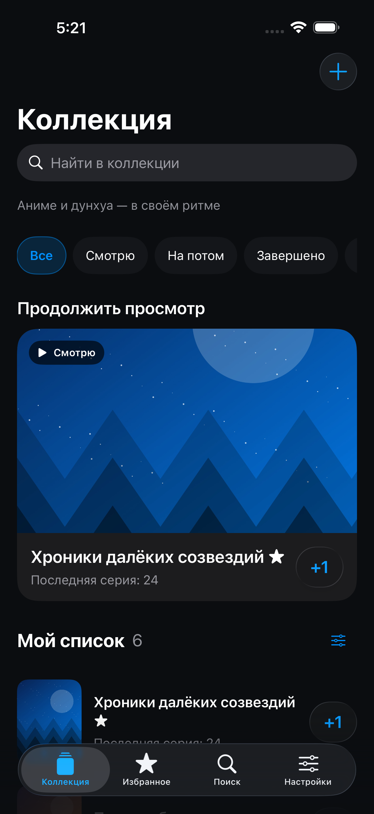
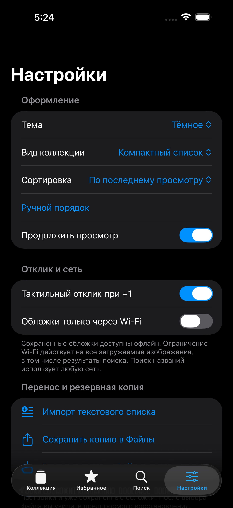
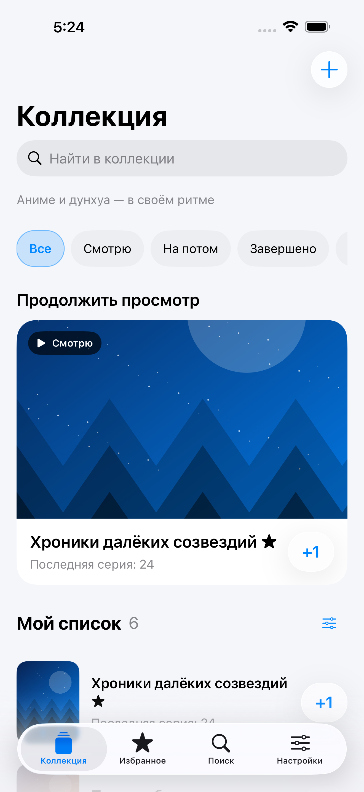

# АниПолка

Нативная личная коллекция аниме и дунхуа для iPhone. SwiftUI, iOS 17+, системное Liquid Glass на iOS 26+. Отдельный проект, bundle ID `com.zakitkh.anipolka`; не связан с LumaSwipe и не заменяет его.

Разработчик — **Закир Халилов**. Создано для личного использования.

**[Скачать готовый IPA 1.0](https://github.com/ZakitKH0000/anipolka-ios/releases/tag/v1.0.0)** · [Установка с Windows](INSTALL_RU.md) · [Результаты проверок](docs/VERIFICATION_RU.md)

  
  
  

Реальные снимки симулятора с тестовыми названиями и локальными иллюстрациями. Официальные обложки выбираются в каталоге при добавлении; при первом обычном запуске коллекция пустая.

## Возможности

- Коллекция со статусами «Смотрю», «На потом», «Завершено», «Заброшено», независимым избранным, заметками и ссылками просмотра.
- Реальный поиск Shikimori по русскому или оригинальному названию, с выбором произведения, сезона и обложки. Прогресс и сезон пользователь задаёт сам; сквозная нумерация поддерживается. Личный список автоматически никуда не передаётся.
- Свои названия, изображения из Фото через системный PhotosPicker; альтернативные изображения выбранного произведения из каталога. Кэш обложек сохраняется в коллекции после загрузки и работает офлайн.
- +1 отмечает последнюю просмотренную серию и сразу сохраняет. Последнее действие можно отменить в течение шести секунд. Редактирование прогресса и подтверждаемое удаление.
- Поиск внутри коллекции, компактный список и сетка, сортировка по просмотру, названию и реальному ручному порядку.
- Тёмная (по умолчанию), светлая и системная темы; отключаемые главная карточка и тактильный отклик.
- Режим обложек «любая сеть / только Wi-Fi»: проверка Network.framework, запрет cellular в URLSession и URLRequest, отмена загрузок при смене политики/потере разрешённого подключения. Поиск метаданных работает через любую сеть.
- Перенос текстового списка с редактируемым предпросмотром. Нераспознанные названия не исправляются; исходные строки видны при проверке. Совпадения по названию с текущей коллекцией не выбраны по умолчанию.
- Резервная копия JSON в «Файлы»: прогресс, заметки, настройки, ручной порядок и встроенные сохранённые изображения. Восстановление с предпросмотром: объединение (текущие UUID сохраняются) или явная замена с подтверждением. Повреждённый импорт ничего не меняет.
- Поддержка Dynamic Type, VoiceOver, Reduce Transparency и Increase Contrast. Сетка при самых крупных шрифтах становится списком; декоративной анимации нет.

## Сборка без Mac

Публичный репозиторий исходного кода: https://github.com/ZakitKH0000/anipolka-ios

Push в main либо ручной запуск Actions → «Сборка и проверка АниПолки». Два задания создают unsigned Release IPA для реального iPhone и отдельно выполняют тесты интерфейса на симуляторе iPhone 17 Pro Max. XcodeGen генерирует проект; сторонних Swift-пакетов нет. Конкретные результаты проверок фиксируются в `docs/VERIFICATION_RU.md` после CI.

Артефакт `AniPolka-unsigned-IPA` содержит IPA, SHA-256 и [инструкцию установки](INSTALL_RU.md). Он хранится 90 дней; готовый IPA также сохраняется локально. Сборка не требует Apple ID или сертификатов; подпись выполняется вашим инструментом на Windows.

Репозиторий открыт по решению владельца для сборки на стандартных GitHub-hosted runners. Личная коллекция, её исходный список и резервные копии в репозиторий и сборку не включаются.

На Mac: `brew install xcodegen`, `xcodegen generate`, открыть `AniPolka.xcodeproj`. Логика без UIKit: `cd Core && swift test`.

## Источники и ограничения

Используется документированный публичный REST API [Shikimori](https://shikimori.io/api/doc), [поиск](https://shikimori.io/api/doc/1.0/animes/index), [изображения произведения](https://shikimori.io/api/doc/1.0/animes/screenshots), [условия](https://shikimori.io/terms). Заголовок User-Agent содержит имя приложения, запросы ограничены до одного в секунду, HTTP 429 включает паузу. Часть дунхуа и переводов может отсутствовать. Повторите поиск по оригинальному названию или добавьте вручную. Изображения принадлежат правообладателям; приложение не распространяет каталог обложек в комплекте.

AniList не используется: его [условия](https://docs.anilist.co/guide/terms-of-use) ограничивают отдельные трекеры. Аккаунт, платный ключ, сервер и синхронизация не нужны. Поиск и первоначальная загрузка обложек требуют интернета; ссылки открываются во внешнем приложении. Face ID, виджеты, напоминания и отдельная история просмотров не входят в эту версию.

Ограничения защиты памяти: до 2000 записей, файл копии до 150 МБ, фото до 20 МБ при выборе, сетевое изображение до 12 МБ; обложки уменьшаются до 1200 пикселей и сохраняются как JPEG. Копия включает только уже загруженные обложки. Удаление приложения удаляет локальные данные: сохраняйте копии в Файлы.

Тестовый аргумент `--demo --reset` создаёт отдельное хранилище с вымышленными названиями и локальными векторными пейзажами. Скриншоты тестов — настоящие снимки симулятора; эти иллюстрации не являются официальными обложками. Обычный запуск начинает с пустой личной коллекции.
